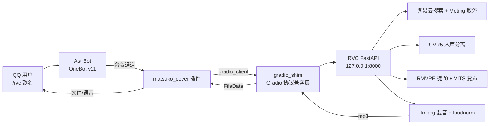

# 给 QQ 机器人装上"歌手嗓"：本地 GPU + RVC 的 AI 翻唱全链路

> 在 QQ 里发一句 `/rvc 去年夏天`，机器人自动完成：**搜歌 → 下载 → 分离人声 → 换成你训练的音色 → 混音 → 回传成品 mp3**。
> 全部跑在本地显卡上，不依赖任何云端 AI 服务，一首歌端到端约 10 秒。

本文记录从零到跑通的全过程：环境搭建、依赖适配、REST 后端与 Gradio 客户端的协议桥接、音乐源选型、机器人接入与 token 成本优化，以及 20 多个真实踩过的坑。

---

## 快速开始（Windows + NVIDIA）

**前提**：Python 3.12（安装时勾选 `Add python.exe to PATH`）、Git、NVIDIA 显卡并装好驱动。

```bat
git clone <本仓库地址>
cd ai-cover-bot
install.bat
```

安装器会自动完成这些事（下载约 4 GB，磁盘占用约 7.6 GB，视网速 10~30 分钟）：

- clone 上游 RVC FastAPI 仓库到 `runtime/`
- 建独立 venv，装 `torch 2.7.1+cu128` 和整套锁定版本的依赖（走国内镜像，失败自动回退官方源）
- 装**预编译好的 fairseq wheel** —— 不需要 MSVC / Cython，直接跳过最难的编译环节
- 打上 torch 2.6 `weights_only` 与 py3.12 dataclass 兼容补丁
- 覆盖上游那 6 个必须改的文件（PyAV、librosa 位置参数、以及我们新增的 `/cover` 与 Gradio 协议层）
- 下载三个公开模型：**HuBERT 底模**（音色特征提取）、**RMVPE**（音高提取）、**UVR5 `HP5_only_main_vocal`**（人声分离）
- 生成 `.env` 和一份**路径已填好的** `runtime/start-backend.bat`（找不到 ffmpeg 时自动使用 `imageio-ffmpeg` 自带的静态二进制）

装完只差一样东西 —— **你自己的音色模型**（这个是个人资产，本来就不该公开分发）：

| 需要 | 放到 |
| --- | --- |
| 音色模型 `*.pth`（自己训练的，或从社区下载的 RVC 模型） | `runtime/Retrieval-based-Voice-Conversion-FastAPI/assets/weights` |
| 可选：检索索引 `*.index`（同音色同名，能提升相似度） | `assets/indices` |

然后双击 `runtime/start-backend.bat`，在机器人插件里填 `http://127.0.0.1:8000` 即可。

> **前置条件**（脚本无法代劳）：Windows 10/11 + NVIDIA 显卡（≥6 GB 显存，已装驱动）+ Python 3.12 + Git。
> 没有 N 卡只能加 `--cpu`，速度慢到不实用。

<details>
<summary><b>✅ 这套安装器实测过（展开看验证记录）</b></summary>

在 RTX 5070 Ti Laptop + Python 3.12.10 上，从**完全空的目录**跑完整流程，结果：

| 环节 | 结果 |
| --- | --- |
| clone 上游 + 建 venv + 装 torch cu128 | ✅ |
| 预编译 fairseq + py3.12 补丁 | ✅ |
| 覆盖 6 个上游文件 | ✅ |
| 自动下载 HuBERT / RMVPE / UVR5 | ✅ 180 + 172 + 60 MB |
| 生成 `.env` 与 `start-backend.bat` | ✅ |
| 启动服务 `/status` → ok，`/models` → 列出模型 | ✅ |
| **`POST /cover` 真实翻唱** | ✅ **200，481 KB mp3，22.8 s**（含首次模型加载） |
| Gradio 协议层 `/config` `/info` | ✅ 4.44.1 / sse_v1 / `/convert` 20 参数 |

实测中修掉的两个坑（见踩坑清单 22、23）：`site.getsitepackages()[0]` 在 venv 里指向 venv 根目录、fairseq 用 `--no-deps` 装后缺 omegaconf 等运行时依赖。

</details>

> **为什么不做成「解压即用」的整合包？** 因为装好的环境约 3~4 GB、音色模型约 760 MB、底模 181 MB，而 GitHub 单文件限 100 MB、仓库建议 <1 GB；且 venv 里是绝对路径，拷贝到别的目录就失效。所以这里选择的是「一次命令安装」，而不是打包分发。

> 补丁基于上游 commit `3299168` 实测。若上游后续有较大改动，以 `patches/upstream/` 里的整文件覆盖为准。

---

## 效果

| 环节 | 实测 |
| --- | --- |
| 端到端（歌名 → 成品 mp3） | **约 10 秒**，输出 705 KB mp3 |
| 纯转换（20 秒音频） | 首次 6.9 s（含模型加载），之后 2.3 s |
| 音色数量 | 14 个（含训练中间权重） |
| 显存占用 | 约 5.9 GB（与另一个常驻的 GPT-SoVITS 共存于 12.2 GB） |

---

## 一、整体架构



关键点：**后端是 REST，插件只认 Gradio**。中间那层 `gradio_shim` 是整个方案能成立的原因，详见第四节。

---

## 二、环境

| 项 | 版本 |
| --- | --- |
| GPU | NVIDIA GeForce RTX 5070 Ti Laptop（sm_120 / Blackwell，需 CUDA 12.8） |
| Python | 3.12.10（独立 venv，放在项目外层，不污染 git 仓库） |
| torch / torchaudio | 2.7.1+cu128 |
| numpy / librosa | 1.26.4 / 0.10.2 |
| faiss-cpu / pyworld / parselmouth | 1.15.1 / 0.3.5 / 0.4.7 |
| onnxruntime-gpu | 1.19.2 |
| fastapi / pydantic / uvicorn / gradio | 0.99.1 / 1.10.27 / 0.22 / 3.14 |
| av (PyAV) | 15.1.0 |
| 机器人 | AstrBot 桌面版 + NapCat/Lagrange（OneBot v11） |
| 翻唱插件 | astrbot_plugin_matsuko_cover（gradio_client 2.7.2） |

> 上游仓库自带的 `requirements.txt` 是 Linux 版（含 `tensorflow-rocm`），且 numpy 1.23.5 / numba 0.56.4 / llvmlite 0.39 / faiss-cpu 1.7.3 只支持 Python 3.10。Windows + py3.12 必须整体重写一份依赖清单。

---

## 三、部署四步

### 1. 建独立环境

```bash
git clone https://github.com/SocAIty/Retrieval-based-Voice-Conversion-FastAPI
python -m venv .venv
pip install torch==2.7.1+cu128 torchaudio==2.7.1+cu128 --index-url https://mirror.nju.edu.cn/pypi/web/simple
pip install -r requirements-win-py312-cu128.txt   # 自己维护的 Windows 清单
```

`torchcrepe==0.0.20` 会强依赖 `librosa==0.9.1`，与 0.10.2 冲突 → 用 `--no-deps` 装它再补 `resampy`，实测兼容（220 Hz 正弦测出 220.8 Hz）。

### 2. 让 fairseq 在 Windows 上活下来（三重障碍）

RVC 用 HuBERT 提特征，而 fairseq 0.12.2 在 Windows / py3.12 上有三个坑：

1. **C 扩展编译失败**：只有 MSVC 而没有 Windows SDK 头文件（`crtdbg.h`）。解法：改 `setup.py` 跳过全部 C/Cython 扩展——RVC 只用 `checkpoint_utils` 加载权重，编译模块用不上。
2. **Python 3.11+ dataclass 收紧可变默认值检查**：用 `.pth` 文件在解释器启动时把 `dataclasses.dataclass` 换成兼容版本（不可哈希默认值 → `default_factory`；标准库 `MISSING` → `omegaconf.MISSING`），只对 fairseq 的类生效。
3. **hydra 初始化不认 `default_factory`**：改 `fairseq/dataclass/initialize.py`，取值时同时考虑 `default` 与 `default_factory`。

顺带：`torch.load` 在 2.6+ 默认 `weights_only=True`，老格式权重会抛 `UnpicklingError` → 在 `checkpoint_utils.py` 两处显式加 `weights_only=False`。

### 3. 补一条 `/cover` 全流程管线

上游只有单段的 `/voice2voice`。翻唱需要三件事串起来，于是新增 `cover_pipeline.py`：

- **分离**：UVR5（HP5_only_main_vocal）。模型用 `UVRModelCache` 缓存，加载一次约 2 s，别每次请求都重载。
- **变声**：RMVPE 提 f0 + VITS 推理。
- **混音**：ffmpeg + `loudnorm=I=-16:TP=-1.5:LRA=11`。**不加响度归一化成品会明显偏小**（实测 RMS 0.059 → 0.115）。

### 4. 一键启动

双击即用的 `.bat`：检测 8000 端口占用 → 设置 `PYTHONPATH` → 启动 uvicorn → 后台监视器轮询到就绪后自动打开 `/docs`。

> 注意：服务随命令行窗口存在，**窗口关掉 = 服务停止**（机器人会立刻报"没有可用的 RVC 模型"）。

---

## 四、最难的一环：让 Gradio 客户端直连 REST 后端

### 问题从哪来

翻唱插件（matsuko_cover）是用 `gradio_client` 写的，它只会说 Gradio 协议。它官方推荐的后端只支持 Windows AMD 显卡，明确写了"NVIDIA 不在支持范围内"——而我们是 NVIDIA。

于是只能反过来：**在 FastAPI 上实现一个最小的 Gradio 服务端**。`GET /config` 里谎报 `version=4.44.1`、`protocol=sse_v1`，客户端就会按这套协议跟我们对话。

### 需要实现的端点

| 端点 | 作用 |
| --- | --- |
| `GET /config` | 声明版本号、协议、伪 components/dependencies |
| `GET /info` | 声明 `/convert` 的 20 个参数名，**顺序必须与客户端调用一致** |
| `POST /queue/join` | 提交任务，返回 `event_id` |
| `GET /queue/data?session_hash=` | SSE 流，推送进度与结果 |
| `GET /file={path}` | 产物下载（白名单限制输出目录） |
| `/reset`、`/heartbeat/{hash}` | 心跳与重置 |

### 四个必踩的坑

1. **提交端点是 `/queue/join`，不是 `/queue/data`**。sse_v1 下 `SSE_DATA_URL="queue/join"`、`SSE_URL="queue/data"`，非常容易搞反。
2. **`event_id` 必须前后一致**：POST 返回的 id 要和 SSE 消息里的 id 是同一个，否则客户端过滤后永远收不到结果——表现为 `predict()` 静默挂死。
3. **`progress_data` 必须是列表**（可以为空 `[]`）。传 `null` 会让客户端的 `ProgressUnit.from_msg` 抛 `TypeError`。
4. **消息格式只要 `data: {json}\n\n`**，不需要 `event:` 行；结束后保持流打开，由客户端自己关闭。

### 参数映射

客户端用的是 RVCSVC 后端的参数契约，需要翻译成本地 RVC 的语义：

| 客户端参数 | 本地语义 |
| --- | --- |
| `model_dropdown` | 模型名（去掉 `.pth` 与 `\|\|\|` 别名后缀） |
| `key_shift` | `f0up_key` |
| `vocal_vol` / `inst_vol` | dB 增益，`10 ** (v / 20)`，0 表示不变 |
| `f0_method` / `index_rate` / `filter_radius` / `uvr5_agg` / `uvr5_tta` | 直接透传 |
| reverb / delay / msst 系列 | RVCSVC 专属，接收但忽略（插件会自动进入兼容模式） |

`song_name_src` 支持四种输入：本地路径、http(s) URL、网易云纯数字 ID、歌名（自动搜索）。返回 `(FileData, "false")` 二元组，客户端会自动把文件下载到本地路径。

---

## 五、音乐源：第三方代理全挂之后

跑通的第一天，插件用的网易云代理站 `wyy.xhily.com` SSL 握手失败，整条链路断在"正在下载"。实测了一圈：

| 源 | 状态 | 结论 |
| --- | --- | --- |
| `wyy.xhily.com` | ❌ | SSL 握手失败，站点已废 |
| `music.163.com` 官方搜索接口 | ✅ | 可用，用于搜歌拿 ID |
| 官方 `/song/enhance/player/url` | ❌ | 无登录凭据时返回 `url: null` |
| `music.163.com/song/media/outer/url` | ❌ | 返回版权占位 HTML，不是音频 |
| `hhlqilongzhu` / `lolimi` 等聚合站 | ❌ | 均已挂 |
| `txqq.pro` 聚合 | ⚠️ | 能通，但给的仍是 outer/url |
| **`api.injahow.cn/meting`** | ✅ | `type=url&id=xxx` 直出真 mp3（480 KB，ID3 头验证通过） |
| QQ 音乐官方接口 | ❌ | 无凭据返回 `result=104003` |

**最终方案：官方接口搜歌拿 ID + Meting 代理取流。** 这样不依赖任何登录态，也不用碰版权外链。

---

## 六、接入 AstrBot

### 三个配置要点

```jsonc
{
  "rvc_base_url": "http://127.0.0.1:8000",      // 指向本地后端
  "rvc_models_keywords": [ ... ],               // 音色白名单，空数组会导致"没有可用模型"
  "default_api": "netease",                     // 走官方搜索，别用已挂的 netease_nodejs
  "local_audio_default_model": "xxx"            // /本地翻唱 不带参数时的默认音色
}
```

### 不重启机器人改配置

AstrBot 的插件配置在启动时读进内存，直接改文件不生效。但 dashboard 提供了 API：

- JWT 用 `cmd_config.json` 里 `dashboard.jwt_secret` 自签（HS256，payload 只需 `username` + `exp`），**不需要面板密码**；
- `GET/PUT /api/v1/plugins/config?plugin_id=...`，PUT 保存后返回"机器人正在热重载插件"，立刻生效。

### LLM token 成本

翻唱本身**不经过大模型**，0 token。但插件注册的 16 个 function tool 定义会**每句话都塞进 prompt**：

| 项 | 体积 |
| --- | --- |
| 16 个工具定义 | 7948 字符（约 5.5k~8k token / 次请求） |
| 停用 10 个用不到的后 | **3696 字符**，省一半以上 |

顺便纠正一个常见误判：AstrBot 的**内置工具是按需注入、不是全量注入**。`web_search=False` 时那十几个搜索工具压根不进 prompt；真正每次硬塞的是 `computer_use_runtime=local` 带来的 7 个 shell/文件工具（约 4000 字符）。

---

## 七、零 token 用法

以 `/` 开头的命令由 AstrBot 命令通道直接拦截，**完全不进大模型**：

| 目的 | 命令 |
| --- | --- |
| 点歌翻唱 | `/rvc 歌名` → 回歌曲序号 → 回音色序号 |
| 发音频翻唱 | 语音/文件和文字 `/本地翻唱` 一起发（或先发音频，5 分钟内发命令） |
| 临时换音色 | `/本地翻唱 <音色名>` |
| 刷新音色列表 | `/刷新rvc模型` |

⚠️ 两个细节：

- `/本地翻唱` 的数字参数会被解析成**升降调**，指定音色必须写名字、不能写序号。
- 插件的自然语言自动触发（关键词"翻唱/转换/处理/变声/修音"）**不会终止事件传播**，翻照做、LLM 照样跑一遍，等于双烧。想省就关掉 `local_audio_auto_trigger`，改用命令。

---

## 八、踩坑清单

| # | 症状 | 根因 / 解法 |
| --- | --- | --- |
| 1 | fairseq 编译失败 | 缺 Windows SDK 头文件 → 跳过 C 扩展 |
| 2 | dataclass 报错 | py3.11+ 收紧可变默认值 → `.pth` 打补丁 |
| 3 | `UnpicklingError` | torch 2.6+ `weights_only=True` → 显式设 `False` |
| 4 | PyAV 打不开音频 | PyAV 15 无 `"rb"` 模式 → 用 `"r"`/`"w"` + `layout="mono"` |
| 5 | 索引文件找不到 | 原实现硬编码 IVF1254 → 按去掉 `_e*_s*` 后缀的基础名模糊匹配 |
| 6 | librosa 报参数过多 | 0.10 起只有一个位置参数 → AST 批量改关键字调用（10 处） |
| 7 | 成品音量很小 | 缺响度归一化 → 加 `loudnorm` |
| 8 | `predict()` 挂死 | SSE 的 `event_id` 与 POST 返回值不一致 |
| 9 | 提交任务 404 | sse_v1 提交端点应为 `/queue/join` |
| 10 | `ProgressUnit` TypeError | `progress_data` 传了 `null`，必须是 `[]` |
| 11 | 机器人报"没有可用模型" | ① 服务没在跑 ② `rvc_models_keywords` 是空数组 |
| 12 | 改配置不生效 | 配置在内存里 → 走 dashboard API 热重载 |
| 13 | 误判插件加载失败 | 插件依赖装在 AstrBot 的 `data/site-packages`，不在其自带 python 的 Lib 里 |
| 14 | 下载卡死 | 第三方代理站 SSL 挂了 → 换官方搜索 + Meting 取流 |
| 15 | ffmpeg 报路径错误 | 必须用 Windows 风格路径，`/tmp` 这类它不认 |
| 16 | 显存 OOM | 与常驻的 GPT-SoVITS 抢显存 → 必要时先停另一个服务 |
| 17 | 后台服务被杀 | 沙箱里 `nohup` 起的进程随 shell 退出 → 用窗口/自启脚本 |
| 18 | QQ 语音条失败 | silk 转码失败，插件自动降级为发文件（成品不受影响） |
| 19 | 内置工具停用失败 | 接口返回 "Builtin tools are read-only" → 只能改 `provider_settings` |
| 20 | 服务一关就失效 | 服务随命令行窗口存在，窗口必须保持开着 |
| 21 | `.bat` 双击一闪而过 | 批处理里的中文按 UTF-8 保存，cmd 用 GBK 解析会读坏脚本（表现为 `netstat` 被截成 `tstat`）。**批处理要写成纯 ASCII 英文**，或存成 ANSI |
| 22 | 安装器报 `fairseq not found after install`，但 pip 明明说装成功了 | `site.getsitepackages()[0]` 在 Windows venv 里返回的是 **venv 根目录**（`.venv`），不是 `.venv\Lib\site-packages` → 改用 `sysconfig.get_paths()["purelib"]` |
| 23 | 启动报 `No module named 'omegaconf'` | fairseq 用 `--no-deps` 装（避免 pip 拉 `omegaconf<2.1` 这种 py3.12 用不了的版本），必须手动补 `omegaconf==2.3.1 hydra-core==1.3.8 bitarray sacrebleu` |
| 24 | 国内装依赖卡 1 小时 | `pip` 默认走 pypi.org，会不停 `ReadTimeout` 重试 → 安装器统一先走清华镜像，失败才回退官方源 |

---

## 九、已知问题 / TODO

- [ ] QQ 语音条（silk）转码失败，目前降级为发送 mp3 文件；需要排查 OneBot 端的 ffmpeg 路径。
- [ ] QQ 音乐源因缺少登录凭据不可用，目前全部走网易云；版权受限的歌会下载失败。
- [ ] 服务尚未做成开机自启，需要手动双击启动脚本。
- [ ] 并发未做队列排队，仅靠插件侧串行化，多用户同时翻唱可能打爆显存。

---

## 附录：仓库内容

```
ai-cover-bot/
├── README.md                          # 本文档
├── install.bat                        # 一键安装入口（双击运行）
├── install.py                         # 安装逻辑：建环境 / 装依赖 / 打补丁 / 下底模
├── requirements-win-py312-cu128.txt   # Windows + py3.12 + CUDA 12.8 依赖清单
├── patches/
│   ├── fairseq-0.12.2-py3-none-any.whl    # 预编译 fairseq（已跳过 C/Cython 扩展，10 MB）
│   ├── fairseq/                       # 装完后覆盖到 site-packages
│   │   ├── checkpoint_utils.py        #   torch 2.6+ 需要 weights_only=False
│   │   ├── dataclass/initialize.py    #   py3.12 的 default_factory 兼容
│   │   └── _rvc_fairseq_py312.py/.pth #   解释器启动时替换 dataclass 行为
│   └── upstream/                      # 覆盖到上游仓库的同名路径
│       ├── rvc_fastapi.py             #   端口 / /cover / /models / 挂载 shim
│       ├── gradio_shim.py             #   Gradio sse_v1 协议最小实现（关键）
│       ├── cover_pipeline.py          #   分离 → 变声 → 混音全链路
│       ├── infer/lib/audio.py         #   PyAV 15 适配
│       ├── infer/lib/uvr5_pack/lib_v5/spec_utils.py   # librosa 0.10 关键字调用
│       └── infer/modules/uvr5/vr.py   #   librosa 0.10 关键字调用
└── tools/
    ├── start-rvc-service.bat          # 启动模板（路径占位，需自己改；install.py 会生成填好路径的版本）
    ├── watch_and_open.py              # 就绪监视器：轮询 8000，通了就打开 /docs
    ├── reload_matsuko_config.py       # 通过 dashboard API 热更新插件配置，无需重启机器人
    ├── disable_unused_tools.py        # 批量停用用不到的 LLM 工具，省 token
    └── test_astrbot_gradio_client.py  # 完全模拟插件调用方式打 /convert 的端到端测试
```

> 安装产物都在 `runtime/`（已加入 `.gitignore`）：`runtime/Retrieval-based-Voice-Conversion-FastAPI/` 是上游仓库，`runtime/.venv` 是隔离环境。
> 仓库内所有路径都是相对路径或 `os.path.expanduser("~")` 推导（AstrBot 数据根默认 `~/.astrbot`），**不含任何机器相关的绝对路径、账号或密钥**。

---

## 许可与致谢

- [SocAIty/Retrieval-based-Voice-Conversion-FastAPI](https://github.com/SocAIty/Retrieval-based-Voice-Conversion-FastAPI) —— 后端骨架
- [AstrBot](https://github.com/AstrBotDevs/AstrBot) —— 机器人框架
- UVR5、RMVPE、VITS、Meting —— 链路中的各个组件

本文所述改动均为在以上开源项目之上的适配层。
